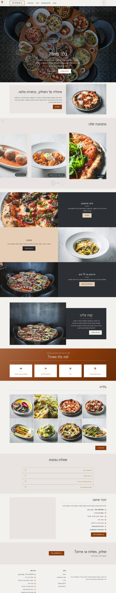
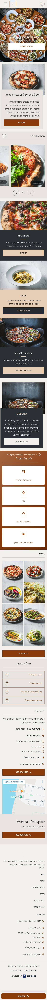
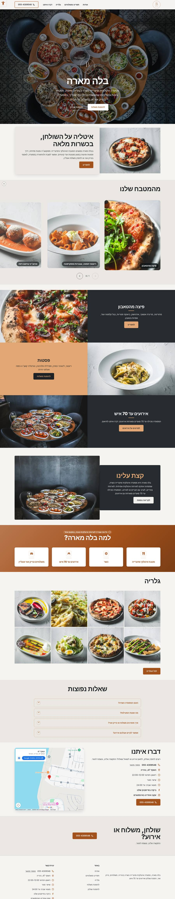
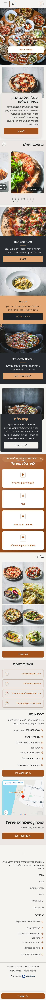
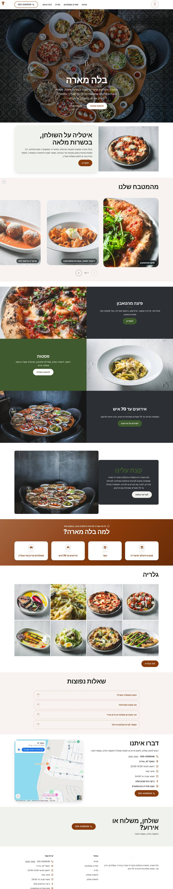
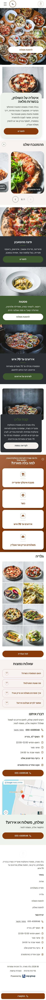

# כיווני עיצוב — בלה מארה

אותו תוכן, אותו מבנה. משתנים רק צבעים, גופנים, פינות וסגנון ה-Hero. בוחרים אות אחת.

## A · A · אבן ונחושת: רקע אבן אפורה כמו בצילומי המנות, נחושת מהלוגו, כותרות דקות כמו אותיות הלוגו, מונוגרמה גדולה על צילום השולחן

סגנון `editorial` · Hero `split` · גופנים Bellefair / Miriam Libre

| מחשב | נייד |
|---|---|
|  |  |

## B · B · ערב בנהריה: צפחה כהה כמו קיר היינות, נחושת חמה, פינות מעוגלות קלות, הכול נשען על הצילומים הכהים

סגנון `bold` · Hero `split` · גופנים David Libre / Alef

| מחשב | נייד |
|---|---|
|  |  |

## C · C · פיצרייה מהטאבון: לבן נקי, ירוק בזיליקום לצד הנחושת, אותיות עבות ושמחות, פינות רכות

סגנון `soft` · Hero `split` · גופנים Suez One / Assistant

| מחשב | נייד |
|---|---|
|  |  |
