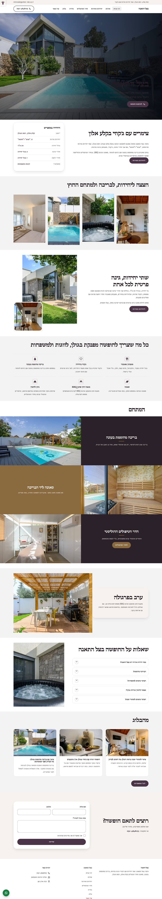
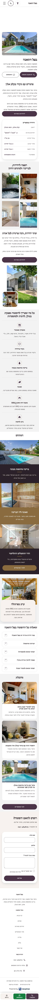
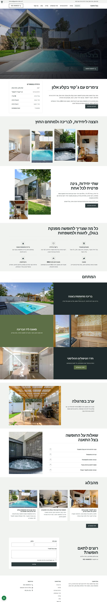
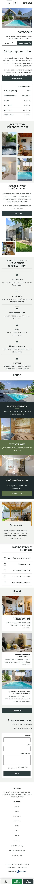
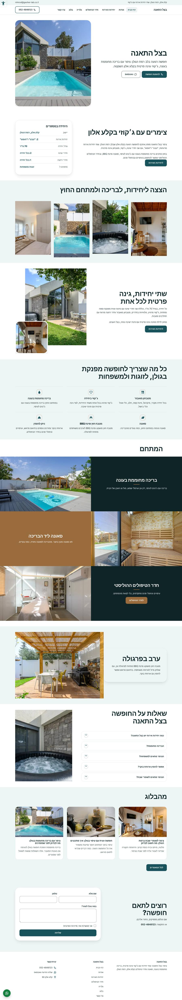
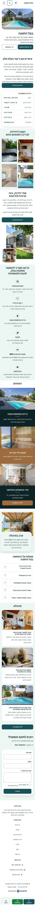

# כיווני עיצוב — בצל התאנה

אותו תוכן, אותו מבנה. משתנים רק צבעים, גופנים, פינות וסגנון ה-Hero. בוחרים אות אחת.

## A · צל התאנה: סגול תאנה, עץ חם, רך ומואר

סגנון `soft` · Hero `image` · גופנים Bona Nova / Alef

| מחשב | נייד |
|---|---|
|  |  |

## B · אבן בזלת: אפור בזלת וירוק עלה, עריכתי וחד

סגנון `editorial` · Hero `image` · גופנים David Libre / Assistant

| מחשב | נייד |
|---|---|
|  |  |

## C · ספא ומים: כחול בריכה עמוק, נקי ומעוגל

סגנון `clean` · Hero `split` · גופנים Rubik / Assistant

| מחשב | נייד |
|---|---|
|  |  |
