# כיווני עיצוב — מרכז שירות יד מרדכי

כל כיוון הוא דף בית שלם משלו: מבנה, סדר הבלוקים, צבעים וגופנים. בוחרים אות אחת.

דמיון בין הכיוונים (מדוד מהדף עצמו): 

## A · הכיוון הנוכחי

ערכה `bands` · סגנון `industrial` · Hero `image` · גופנים IBM Plex Sans Hebrew / Heebo

מבנה: hero:cover → logos:band → facts → reviews → cards → split:frame → steps:cards → features:checks → split → cta → faq:outline

| מחשב | נייד |
|---|---|
| 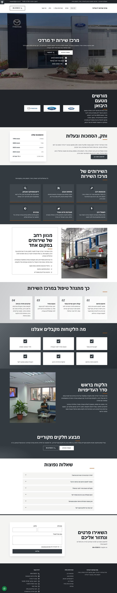 | 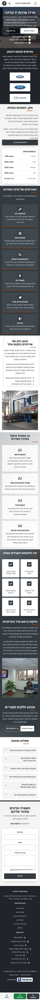 |

## שאר עמודי האתר

הצילומים הם של הבנייה המקומית. בלוק חוות הדעת מדפי זהב נטען רק באתר שעלה לשרת, ולכן הוא ריק כאן.

| עמוד | מחשב | נייד |
|---|---|---|
| אודות | 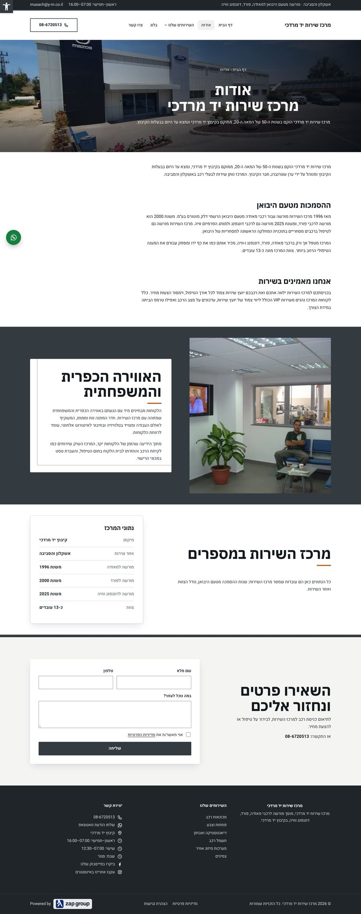 | 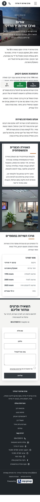 |
| מכונאות רכב (עמוד שירות) | 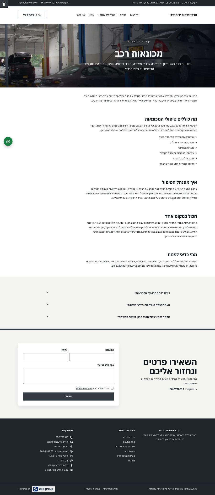 | 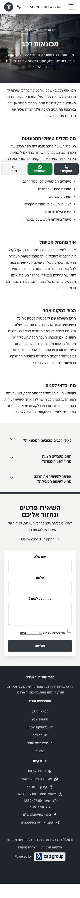 |
| צרו קשר | 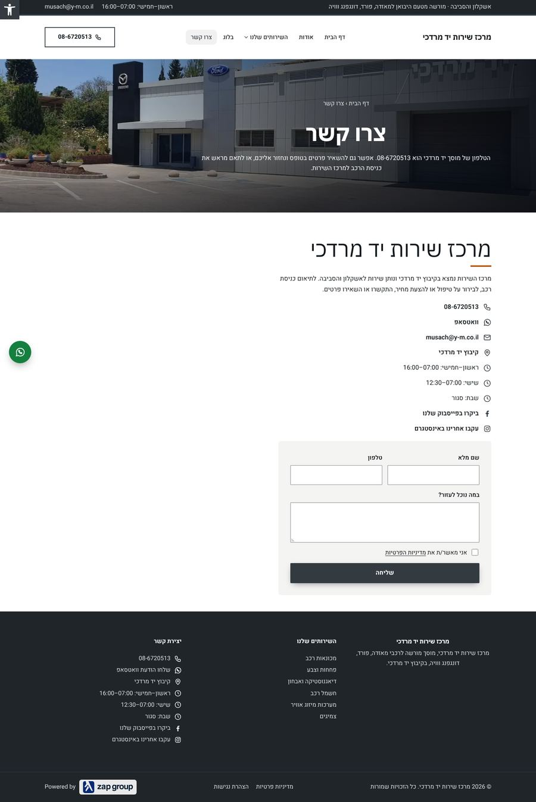 | 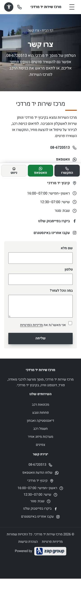 |
| בלוג | 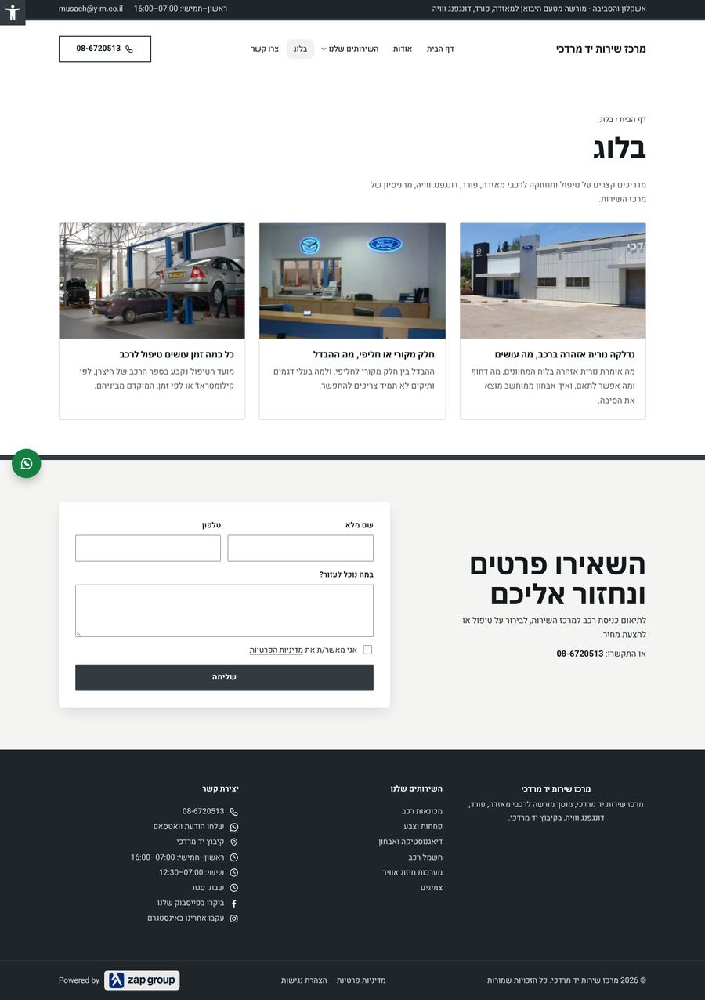 | 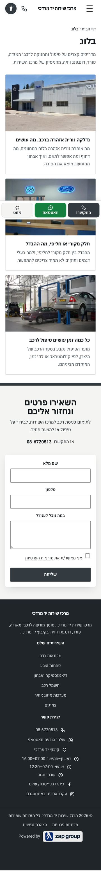 |
| פוסט בבלוג | 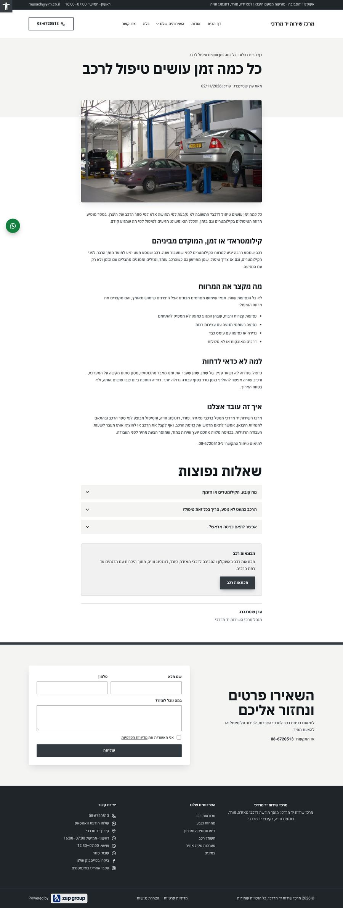 | 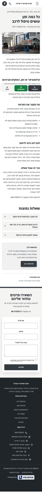 |

## מה נמדד

| בדיקה | תוצאה |
|---|---|
| `zs qa` | 0 שגיאות, 0 אזהרות |
| `zs seo` (צ'קליסט SEO של הצוות) | 0 FAIL |
| ייחודיות מול כל לקוח אחר | 39% לכל היותר (הסף הוא 40%) |

## מה פתוח

ריכוז מלא ב-`OPEN-ITEMS.md`. העיקר: לעסק אין לוגו בשום מקום (נבדק גם באתר הקיים, בפייסבוק ובאינסטגרם),
חסרים הלוגואים של דונגפנג ווויה, והאתר הקיים מציג מספר מקשר זאפ (072-3263207) שלא מופיע באיפיון.
