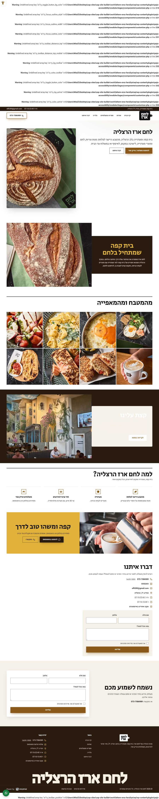
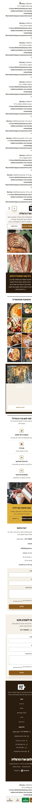
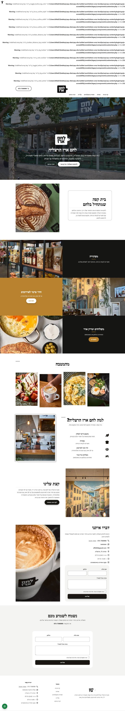
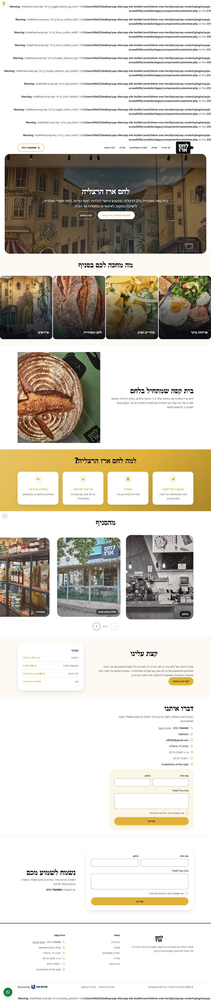

# כיווני עיצוב — לחם ארז הרצליה

כל כיוון הוא דף בית שלם משלו: מבנה, סדר הבלוקים, צבעים וגופנים. בוחרים אות אחת.

דמיון בין הכיוונים (מדוד מהדף עצמו): A–B 49%, A–C 29%, B–C 50%

## A · מאפייה של בוקר: אוכל בתמונה גדולה, טיפוגרפיה חזקה

ערכה `magazine` · סגנון `bold` · Hero `split` · גופנים Secular One / Heebo

מבנה: hero → split:overlap → gallery:mosaic → split:card → features → cta:photo → contact

| מחשב | נייד |
|---|---|
|  |  |

## B · מעדנייה שכונתית: החזית והלוגו, מסגרות דקות, שקט ומוקפד

ערכה `atelier` · סגנון `editorial` · Hero `image` · גופנים Noto Serif Hebrew / Noto Sans Hebrew

מבנה: hero:cover → split:frame → tiles → gallery:stagger → features:aside → split → contact:photo

| מחשב | נייד |
|---|---|
|  |  |

## C · שולחן ירוק: ציור הקיר, כרטיסי תפריט, צבע ירוק המפיות

ערכה `gallery` · סגנון `soft` · Hero `centered` · גופנים Suez One / IBM Plex Sans Hebrew

מבנה: hero:inset → cards → split → features:checks → carousel → facts → contact

| מחשב | נייד |
|---|---|
|  |  |
