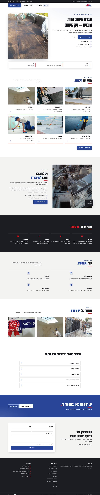
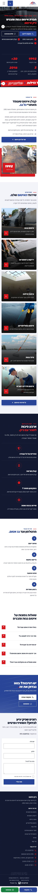
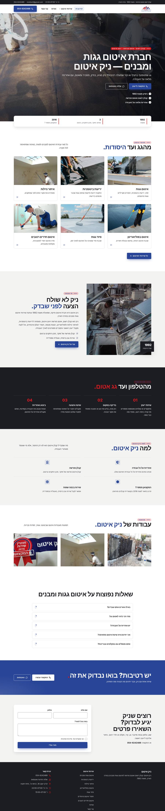
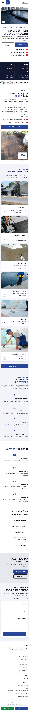
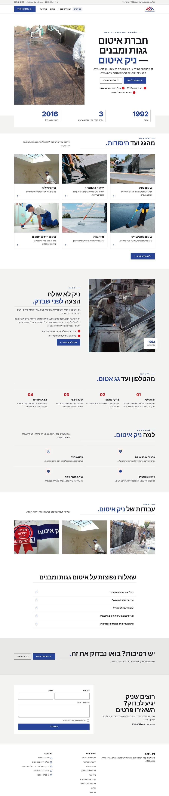
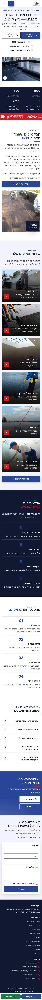

# כיווני עיצוב — ניק איטום

אותו תוכן, אותו מבנה. משתנים רק צבעים, גופנים, פינות וסגנון ה-Hero. בוחרים אות אחת.

## A · קבלן בשטח: חד ותעשייתי, Karantina דחוסה, תמונת עבודה אמיתית בצד, פסי אדום

סגנון `industrial` · Hero `split` · גופנים Karantina / Heebo

| מחשב | נייד |
|---|---|
|  |  |

## B · חזק ובולט: תמונת גג מלאה, כותרות Suez One, כפתורים עם צל

סגנון `bold` · Hero `image` · גופנים Suez One / Assistant

| מחשב | נייד |
|---|---|
|  |  |

## C · ותיק ושקט: בהיר בלי רקעים כהים, כותרות סריף, פתיחה ממורכזת

סגנון `editorial` · Hero `centered` · גופנים Noto Serif Hebrew / Heebo

| מחשב | נייד |
|---|---|
|  |  |
