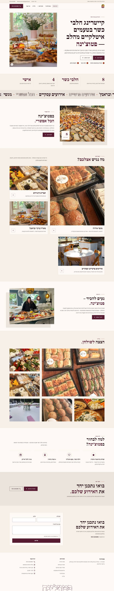
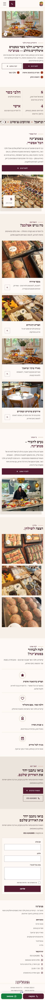
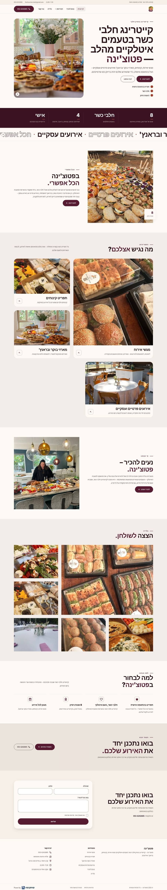
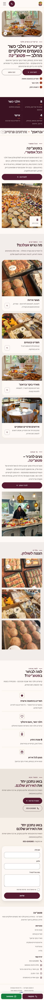
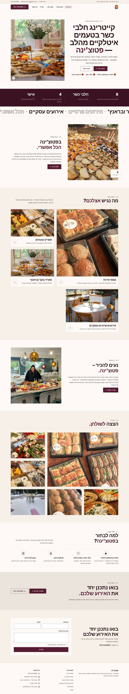
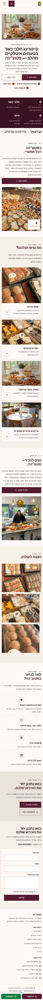

# כיווני עיצוב — פטוצ'ינה

אותו תוכן, אותו מבנה. משתנים רק צבעים, גופנים, פינות וסגנון ה-Hero. בוחרים אות אחת.

## A · A · בוטיק איטלקי בהיר – סריף, שזיף ובז', סליידר תמונות (בהשראת teffee בגרסה בהירה)

סגנון `clean` · Hero `split` · גופנים Frank Ruhl Libre / Assistant

| מחשב | נייד |
|---|---|
|  |  |

## B · B · חם ורך – כותרות מודרניות, פינות מעוגלות, כפתורי גלולה

סגנון `soft` · Hero `split` · גופנים Rubik / Assistant

| מחשב | נייד |
|---|---|
|  |  |

## C · C · מגזיני – טיפוגרפיה עדינה, קווים דקים, פתיח ממורכז

סגנון `editorial` · Hero `centered` · גופנים David Libre / Miriam Libre

| מחשב | נייד |
|---|---|
|  |  |
