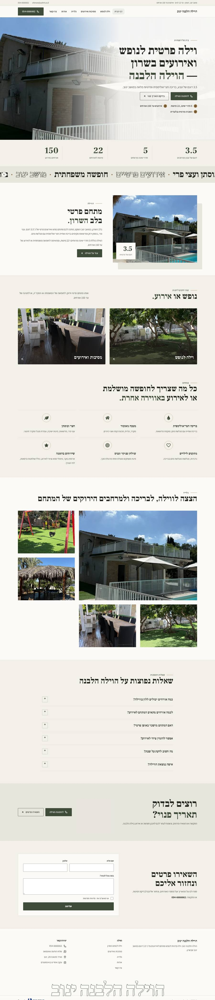
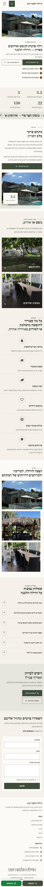
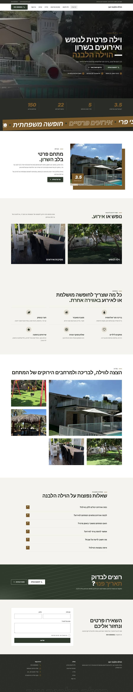
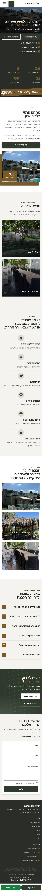
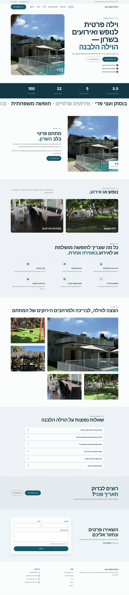
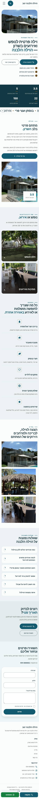

# כיווני עיצוב — הוילה הלבנה ינוב

אותו תוכן, אותו מבנה. משתנים רק צבעים, גופנים, פינות וסגנון ה-Hero. בוחרים אות אחת.

## A · A · לבן כפרי יוקרתי: רקעים בהירים, כותרות סריף, ירוק זית ופליז, וידאו הבריכה בפתיחה

סגנון `clean` · Hero `split` · גופנים Frank Ruhl Libre / Assistant

| מחשב | נייד |
|---|---|
|  |  |

## B · B · חגיגי ונועז: כותרות כבדות, ניגודיות גבוהה, פס סלוגנים ומספרים גדולים

סגנון `clean` · Hero `split` · גופנים Rubik / Assistant

| מחשב | נייד |
|---|---|
|  |  |

## C · C · קיץ ובריכה: גוון מים, פינות רכות, תחושת חופשה משפחתית

סגנון `soft` · Hero `split` · גופנים Varela Round / Assistant

| מחשב | נייד |
|---|---|
|  |  |
